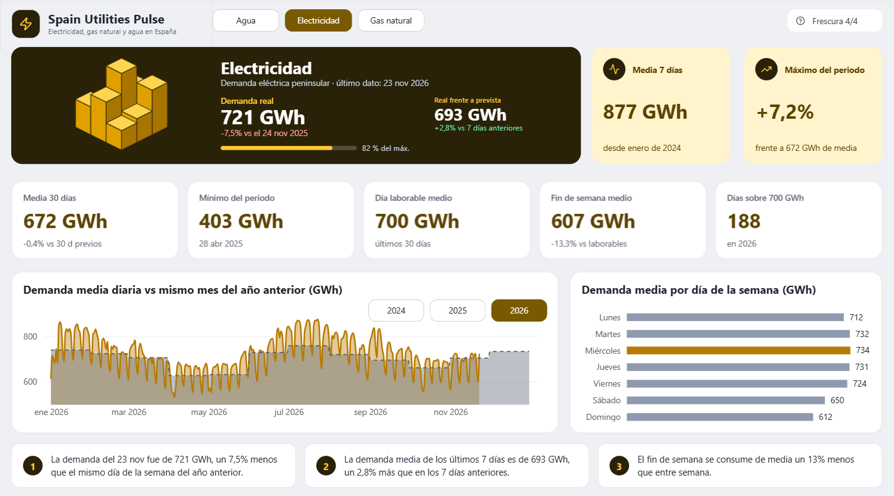
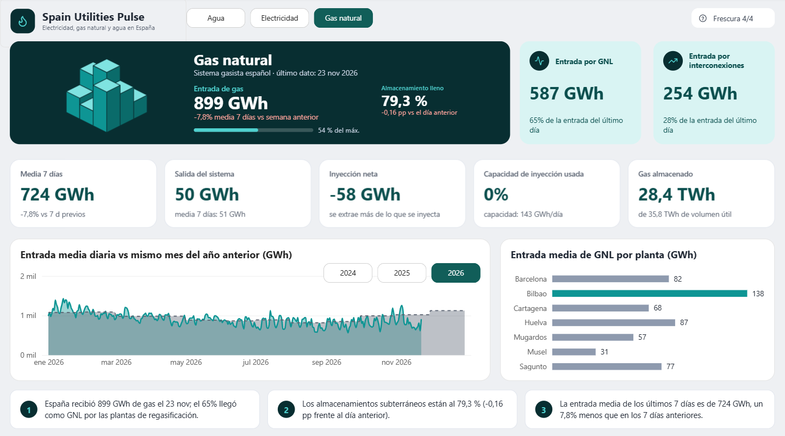
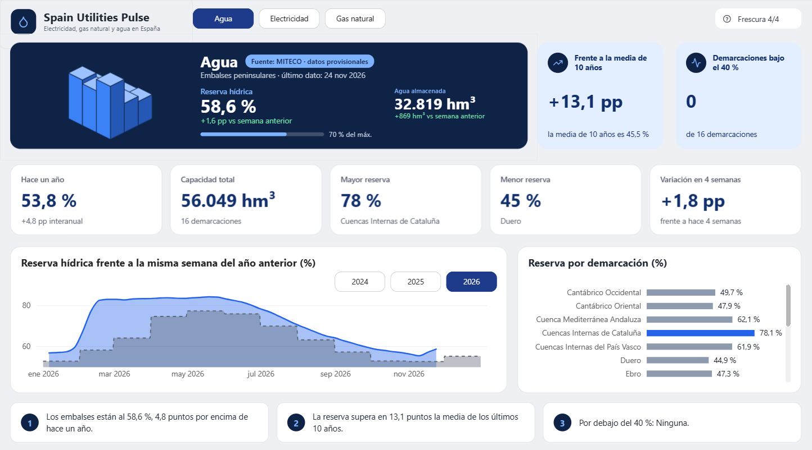
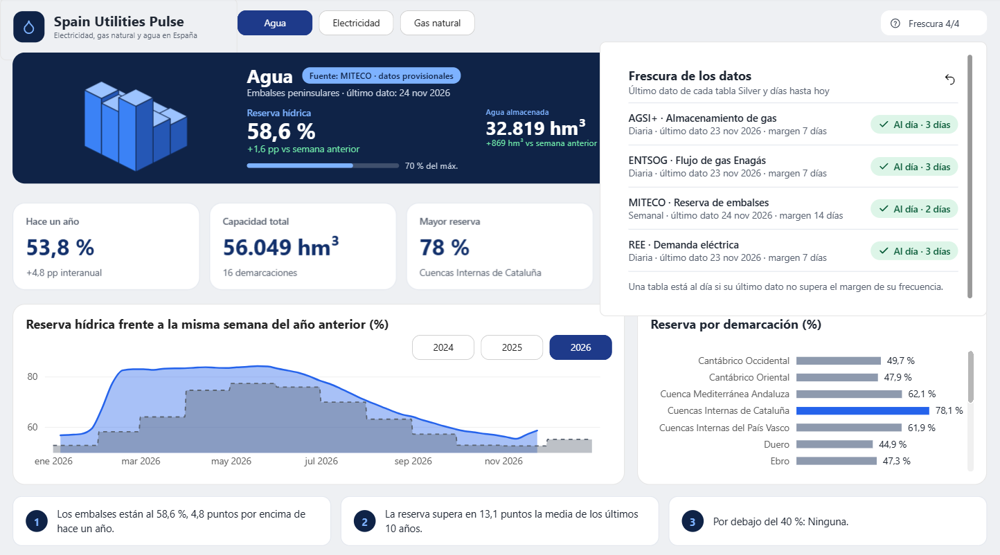
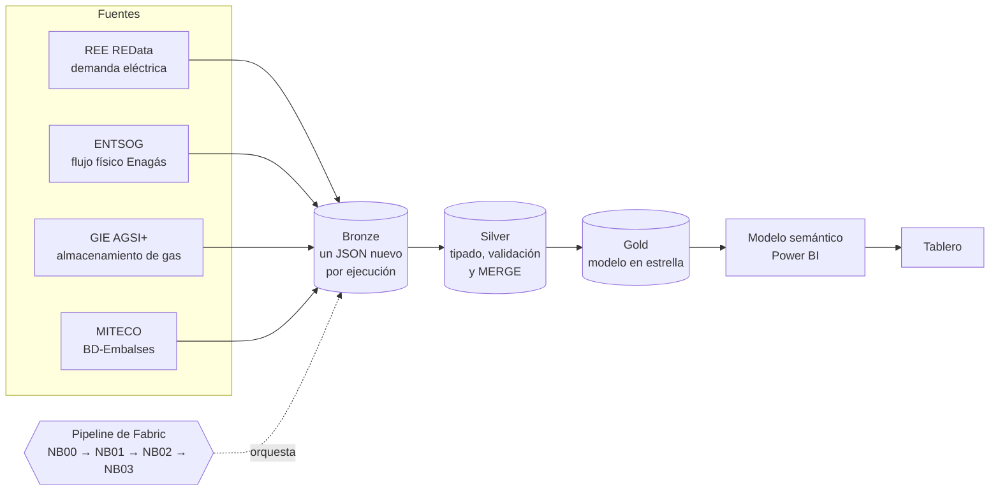

# 01 · Spain Utilities Pulse

Tablero de una página que responde a **¿cómo están hoy la electricidad, el gas natural y el agua en España?** Los datos salen de cuatro fuentes públicas (REE, ENTSOG, GIE AGSI+ y MITECO), se cargan en un Lakehouse de Microsoft Fabric con **carga incremental** y arquitectura medallón (Bronze, Silver y Gold) y se muestran en Power BI. Un selector de tres sectores cambia todo el tablero, y un panel de frescura indica si las cuatro fuentes están al día.

> **Diseño propio**, inspirado en referencias de tableros vistas en internet.



*Electricidad: demanda peninsular del último día, comparación con el mismo día de la semana del año anterior, indicadores del período y demanda media por día de la semana.*

<table>
<tr>
<td width="50%"><br><em>Gas natural: entrada de gas al sistema, peso del GNL y de las interconexiones, almacenamiento subterráneo y entrada media por planta de GNL.</em></td>
<td width="50%"><br><em>Agua: reserva de los embalses peninsulares, comparación con hace un año y con la media de 10 años, y reserva por demarcación.</em></td>
</tr>
</table>



*El panel de frescura, que se abre desde el botón «Frescura 4/4»: último dato de cada tabla Silver, días hasta hoy y si está al día según el margen de su frecuencia.*

Capturas con datos hasta el 23 nov 2026 (24 nov en el caso del agua).

## Qué muestra el tablero
| Bloque | Electricidad | Gas natural | Agua |
|---|---|---|---|
| Banner | Demanda real del último día y media de 7 días | Entrada de gas del último día y almacenamiento lleno (%) | Reserva hídrica (%) y agua almacenada (hm³) |
| Tarjetas laterales | Dos datos de contexto del período | Entrada por GNL y por interconexiones | Diferencia con la media de 10 años y demarcaciones por debajo del 40 % |
| Indicadores | Media 30 días, mínimo, día laborable medio, fin de semana medio y días sobre 700 GWh | Media 7 días, salida del sistema, inyección neta, capacidad de inyección usada y gas almacenado | Hace un año, capacidad total, mayor y menor reserva y variación en 4 semanas |
| Gráfico de línea | Demanda media diaria frente al mismo mes del año anterior | Entrada media diaria frente al mismo mes del año anterior | Reserva frente a la misma semana del año anterior |
| Barras | Demanda media por día de la semana | Entrada media de GNL por planta | Reserva por demarcación |

Además, en todos los sectores:
- **Selector de sector** con icono: cambia colores, ilustración, textos y gráficos.
- **Ilustración isométrica** del banner dibujada en SVG desde DAX, con los colores del sector.
- **Indicadores con volteo:** al pasar el cursor, la tarjeta se gira y explica el indicador.
- **Filtro de año** (2024, 2025 y 2026) en el gráfico de línea.
- **Tres claves** en el pie: frases generadas con DAX que resumen el último dato.
- **Panel de frescura** con el estado de las cuatro fuentes.

## Arquitectura


Todo vive en el espacio de trabajo `WS_Utilities_Pulse`, con un Lakehouse `LH_Utilities` con esquemas habilitados (`silver` y `gold`).

| Paso | Notebook | Qué hace |
|---|---|---|
| Validación | [`NB00_Validating`](notebooks/NB00_Validating.ipynb) | Comprueba que REE, ENTSOG y AGSI+ responden y devuelven datos desde 2024. No escribe nada |
| Bronze | [`NB01_Bronze_Utilities`](notebooks/NB01_Bronze_Utilities.ipynb) | Descarga incremental de las cuatro fuentes a `Files/bronze/<fuente>/` en JSON |
| Silver | [`NB02_Silver_Utilities`](notebooks/NB02_Silver_Utilities.ipynb) | Tipa, valida y hace `MERGE` en tablas Delta del esquema `silver` |
| Gold | [`NB03_Gold_Utilities`](notebooks/NB03_Gold_Utilities.ipynb) | Reconstruye el modelo en estrella del esquema `gold`, calcula los datos de comparación del agua y la tabla de frescura |

Un pipeline de Fabric ejecuta los cuatro notebooks en orden. NB01, NB02 y NB03 lanzan un error si algo falla, así que el pipeline se detiene y no publica datos a medias.

### Carga incremental
- **Primera ejecución:** descarga todo desde el 1 de enero de 2024 (2014 en el agua).
- **Siguientes:** pide desde la última fecha guardada menos un **solape** (7 días; 8 semanas en el agua, porque MITECO publica datos provisionales que revisa después). La última fecha va en el nombre del archivo (`..._hasta20261122.json`), así que no hace falta abrir los JSON.
- **Bronze no se sobrescribe:** cada ejecución escribe un archivo nuevo por fuente.
- **Silver se queda con el último valor descargado** de cada clave y hace `MERGE`: inserta las claves nuevas y actualiza solo las filas que han cambiado. Volver a ejecutar no duplica nada.
- **Días incompletos:** REE y ENTSOG solo aceptan días con al menos 2 días de antigüedad.
- **Gold se reconstruye completo** en cada ejecución a partir de Silver.

### Fuentes de datos
| Sector | Fuente | Datos | Frecuencia | Desde |
|---|---|---|---|---|
| Electricidad | [REE · REData](https://www.ree.es/es/datos/apidatos) | Demanda eléctrica peninsular | Diaria | 2024 |
| Gas natural | [ENTSOG Transparency Platform](https://transparency.entsog.eu) | Flujo físico de Enagás en 15 puntos (plantas de GNL, interconexiones, almacenamientos…) | Diaria | 2024 |
| Gas natural | [GIE AGSI+](https://agsi.gie.eu) | Almacenamiento subterráneo de gas de España | Diaria | 2024 |
| Agua | [MITECO · Boletín hidrológico](https://www.miteco.gob.es/es/agua/temas/evaluacion-de-los-recursos-hidricos/boletin-hidrologico.html) | Reserva por embalse (base Access con histórico desde 1988), agregada en 16 demarcaciones | Semanal | 2014 (Gold publica desde 2024) |

AGSI+ necesita una clave gratuita; el resto son abiertas.

## Modelo semántico
Esquema en estrella en modo **Importar**, con origen en las tablas `gold` del Lakehouse.

| Tipo | Tablas |
|---|---|
| Dimensiones | `dim_fecha`, `dim_serie_demanda`, `dim_punto_gas`, `dim_direccion_gas`, `dim_ambito_agua` |
| Hechos | `fact_demanda_diaria`, `fact_flujo_gas_diario`, `fact_almacenamiento_gas_diario`, `fact_reserva_agua_semanal` |
| Frescura | `fact_frescura` |
| Tablas calculadas | `Sector` (selector), `Contenido` (textos de tarjetas e indicadores), `Cubos` (ilustración isométrica), `Barras` (categorías del gráfico de barras), `Slots Clave` (las tres claves) y `Medidas` |
| Medidas | 114 medidas DAX: 79 en la tabla `Medidas` (carpetas Electricidad, Gas, Agua y gráficos) y 35 en la tabla `Sector` (paleta, banner, tarjetas, indicadores y HTML) |

Todas las medidas, tablas calculadas y relaciones están en [`docs/medidas.md`](docs/medidas.md).

Algunas decisiones del modelo:
- **Cálculos pesados aguas arriba.** La media de 10 años y la reserva del año anterior del agua se calculan en Gold con PySpark; en DAX solo se dividen entre la capacidad.
- **Un visual para tres sectores.** El gráfico de barras y el de línea son únicos: la tabla `Barras` une las categorías de los tres sectores y las medidas devuelven el valor del sector activo.
- **HTML generado con DAX.** Banner, tarjetas, indicadores, claves y panel de frescura son medidas que devuelven HTML y se muestran con el visual *HTML Content*.

## Validaciones y frescura
| Capa | Validación |
|---|---|
| Validación | NB00 comprueba que las APIs responden y cubren la ventana desde 2024 |
| Bronze | Si una fuente falla o se omite, el notebook lanza un error y el pipeline se detiene |
| Silver | Descarta filas sin fecha, sin clave o sin valor, y valores negativos (o cero en la demanda) |
| Silver | Excluye los días de REE y ENTSOG todavía incompletos |
| Silver | Ninguna tabla vacía y ninguna clave natural repetida |
| Gold | Excluye valores atípicos del gas (más de 10 veces el percentil 99 de su punto y dirección) y los lista al ejecutar |
| Gold | Ninguna tabla vacía, ninguna clave repetida y ningún valor de un hecho sin su fila en la dimensión |
| Tablero | Panel de frescura: cada fuente está al día si su último dato no supera 7 días (diarias) o 14 (MITECO, semanal) |

Volúmenes tras la ejecución del 25 nov 2026:

| Tabla Gold | Filas |
|---|---|
| `fact_demanda_diaria` | 1.058 |
| `fact_flujo_gas_diario` | 19.213 |
| `fact_almacenamiento_gas_diario` | 1.058 |
| `fact_reserva_agua_semanal` | 2.432 (16 demarcaciones) |

## Estructura de la carpeta
```
01_spain-utilities-pulse/
├── README.md
├── notebooks/          Los 4 notebooks (.ipynb), sin salidas y listos para importar
├── docs/
│   ├── medidas.md      Medidas DAX, tablas calculadas y relaciones
│   └── *.png           Capturas del tablero y del panel de frescura
├── powerbi/
│   ├── 01-Spain_Utilities_Pulse.pbip   Proyecto de Power BI (PBIP, informe en formato PBIR)
│   └── paleta_colores.json
└── fabric/             Reservada para los elementos de Fabric sincronizados con Git
```

## Cómo replicarlo en tu entorno
1. **Espacio de trabajo.** Crea uno en Microsoft Fabric con capacidad (sirve la prueba gratuita).
2. **Lakehouse.** Crea un Lakehouse con **esquemas habilitados**.
3. **Clave de AGSI+.** Regístrate gratis en [agsi.gie.eu](https://agsi.gie.eu). En *Files* del Lakehouse, crea la carpeta `config` y sube `utilities_config.json` con el contenido `{"agsi_key": "TU_CLAVE"}`. La clave no se guarda en los notebooks.
4. **Notebooks.** Importa los cuatro archivos de `notebooks/` y asocia tu Lakehouse como predeterminado en cada uno (el enlace al Lakehouse del autor no se incluye).
5. **Pipeline.** Crea un pipeline con cuatro actividades de notebook encadenadas «al completarse correctamente»: NB00 → NB01 → NB02 → NB03. Ejecútalo: la primera vez descarga toda la historia.
6. **Informe.** Abre `powerbi/01-Spain_Utilities_Pulse.pbip` en Power BI Desktop, cambia el origen de datos a tu Lakehouse y actualiza.
7. **Visual HTML Content.** Instálalo desde AppSource (*Obtener más visuales*). El tablero lo usa para el banner, las tarjetas, los indicadores, las claves, el título y el panel de frescura.

## Diseño
La paleta de colores, por sector y por elemento, está en [`powerbi/paleta_colores.json`](powerbi/paleta_colores.json). Cada sector tiene su color: ámbar para la electricidad, verde azulado para el gas y azul para el agua.

## Datos y recursos
- Electricidad: [Red Eléctrica (REData)](https://www.ree.es/es/datos/apidatos).
- Gas natural: [ENTSOG Transparency Platform](https://transparency.entsog.eu) y [GIE AGSI+](https://agsi.gie.eu).
- Agua: [Ministerio para la Transición Ecológica y el Reto Demográfico (MITECO)](https://www.miteco.gob.es). Los datos de las últimas semanas son provisionales.
- Proyecto personal con fines educativos. No está afiliado a ninguna de las fuentes.
