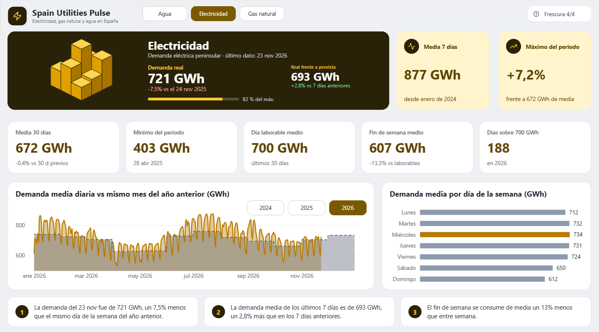

# Portfolio BI · Microsoft Fabric

Proyectos de analítica de principio a fin construidos con **Microsoft Fabric** y **Power BI** sobre arquitectura medallón (Bronze, Silver y Gold). Cada proyecto va desde datos públicos en bruto hasta un tablero terminado, con carga incremental, validaciones de calidad de datos y un modelo semántico documentado.

## Proyectos

| # | Proyecto | Pregunta que responde | Fuentes | Estado |
|---|---|---|---|---|
| 01 | [Spain Utilities Pulse](01_spain-utilities-pulse) | ¿Cómo están hoy la electricidad, el gas natural y el agua en España? | REE, ENTSOG, GIE AGSI+ y MITECO | Terminado |

## Tecnologías

- Microsoft Fabric: Lakehouse con esquemas, notebooks y pipelines
- PySpark y tablas Delta (`MERGE`, particiones, validaciones)
- Power BI: modelo en estrella, DAX y visuales HTML generados con DAX
- Proyectos de Power BI en formato PBIP/PBIR, versionados en Git

## Estructura del repositorio

Cada proyecto vive en su propia carpeta numerada con su README, sus notebooks, sus elementos de Fabric y sus archivos de Power BI.

## Autor

Proyecto personal de Diego para seguir aprendiendo como consultor de Business Intelligence. Voy contando los avances en LinkedIn.
